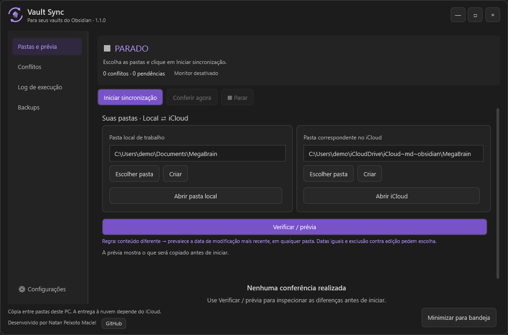
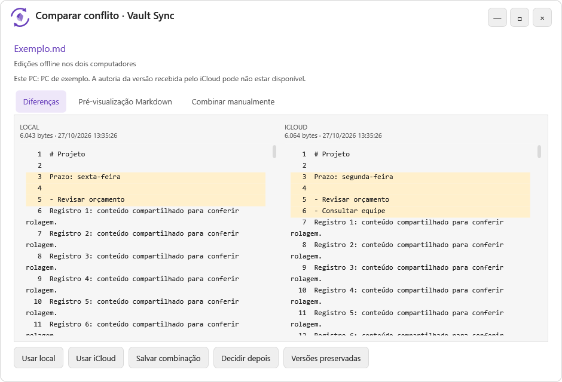
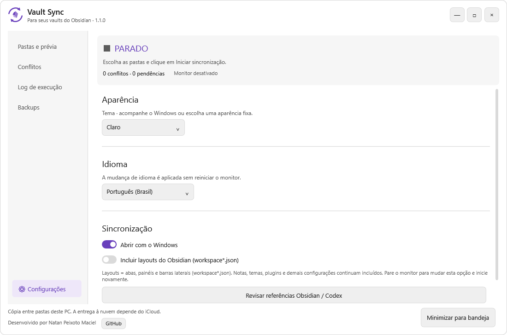

<p align="center">
  
</p>

<p align="center">
  <strong>Trabalhe no seu vault local. Mantenha a pasta do iCloud alinhada.</strong><br>
  Windows x64 · Português, English e Español · Temas claro e escuro
</p>

<p align="center">
  <a href="https://github.com/natpxt/Vault-Sync-Obsidian/releases/latest"><strong>↓ Baixar para Windows</strong></a>
  &nbsp; · &nbsp;
  <a href="docs/manual.md">Manual completo</a>
  &nbsp; · &nbsp;
  <a href="docs/release-v1.1.0.md">Novidades da versão 1.1.0</a>
</p>

## Seu vault, sob controle

O Vault Sync observa uma pasta local e sua correspondente no iCloud deste PC. Ele copia as alterações nos dois sentidos, mostra pendências e permite revisar conflitos lado a lado.



| Sincronização visível | Escolhas claras | Do seu jeito |
| --- | --- | --- |
| Estado do monitor, pendências e histórico de operações. | Prévia de alterações e comparação antes de resolver um conflito. | Três idiomas, temas Sistema/Claro/Escuro e execução pela bandeja. |

<table>
  <tr>
    <td width="50%"><br><strong>Compare e resolva</strong><br>Diferenças, preview Markdown e combinação manual.</td>
    <td width="50%"><br><strong>Escolha sua aparência</strong><br>Troque tema e idioma sem reiniciar o monitor.</td>
  </tr>
</table>

## Comece em três passos

### 1. Instale

Baixe o **[instalador mais recente](https://github.com/natpxt/Vault-Sync-Obsidian/releases/latest)** e execute. Ele inclui o runtime, instala apenas para seu usuário e cria o atalho no menu Iniciar. Não exige administrador nem SDK.

> Ao atualizar, encerre a versão anterior antes de instalar. Os vaults e o estado local são preservados.

### 2. Escolha as pastas

Em **Pastas e prévia**, escolha a pasta local de trabalho e o vault correspondente no iCloud. No iCloud para Windows, mantenha os arquivos baixados neste dispositivo antes de começar.

### 3. Confira e inicie

Use **Verificar / prévia** para revisar as diferenças e clique em **Iniciar sincronização**. Acompanhe as operações no **Log de execução** e revise o que aparecer em **Conflitos**.

**Pausar** suspende temporariamente; **Parar** desativa o monitor. **Minimizar para bandeja** mantém a execução. Abrir o aplicativo novamente traz a janela de volta. O botão **×** encerra o programa.

## Como seus arquivos são tratados

- **Conteúdo igual é sincronizado:** a comparação usa SHA-256, mesmo quando as datas diferem.
- **Conteúdo diferente:** prevalece a data de modificação mais recente. Empates e exclusão contra edição exigem uma escolha.
- **Arquivo ocupado:** fica pendente para nova tentativa; os demais podem continuar.
- **Backup opcional:** disponível em sua própria área, separado das configurações.

> A confirmação vale entre as duas pastas deste PC. O envio aos outros dispositivos é feito pelo iCloud. Use apenas um sincronizador por par de pastas e mantenha os relógios dos dispositivos corretos.

Detalhes sobre recuperação, arquivos grandes e layouts do Obsidian estão no **[manual de uso](docs/manual.md)**.

## Desenvolvimento

C# · .NET 8 · WPF · SQLite. Sem telemetria do aplicativo; fontes e recursos da interface são locais.

```powershell
./scripts/build.ps1 -Publish
```

O script compila, executa os testes do núcleo, o smoke da interface e a verificação isolada do instalador. Builds e fixtures ficam em `%LOCALAPPDATA%/VaultSyncBuild`; o instalador e seu SHA-256 ficam em `dist/`. Use `-SkipUi` em ambientes sem desktop interativo.

[Arquitetura](docs/arquitetura.md) · [Operação](docs/operacao.md) · [Identidade visual](docs/identidade-visual.md) · [Avisos de terceiros](THIRD-PARTY-NOTICES.md)

---

Desenvolvido por **[Natan Peixoto Maciel](https://github.com/natpxt)**.

Projeto independente, sem afiliação à Obsidian ou à Apple. O código ainda não possui uma licença aberta; as licenças das dependências estão nos avisos de terceiros. O instalador ainda não tem assinatura comercial.
